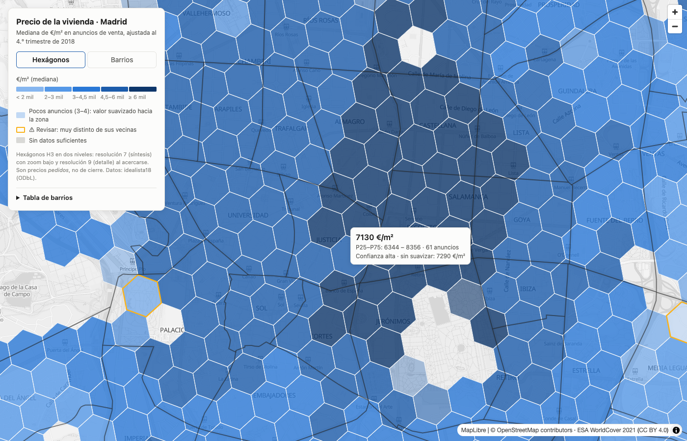
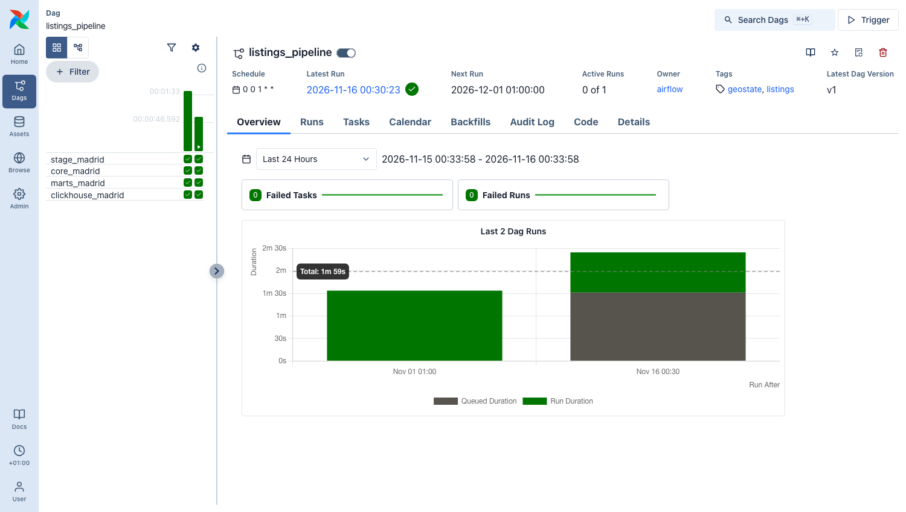
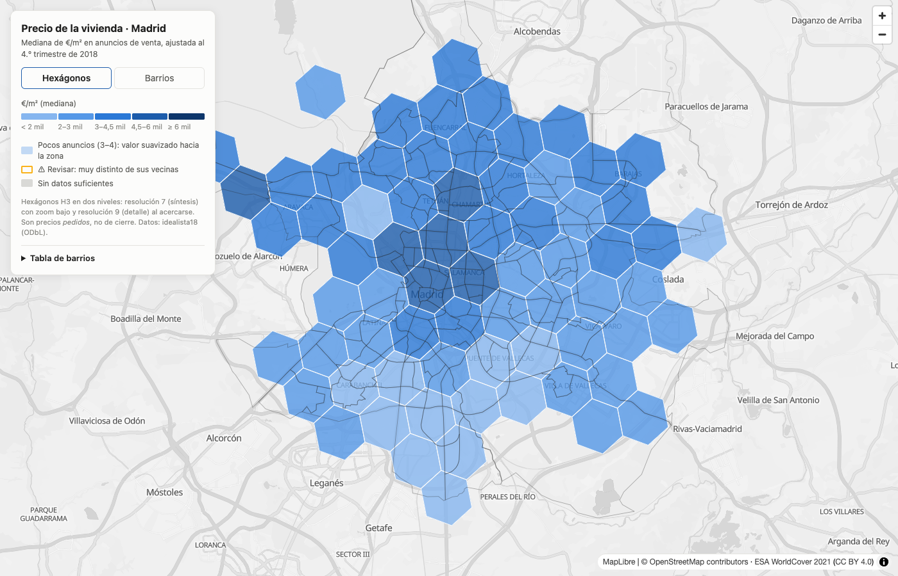
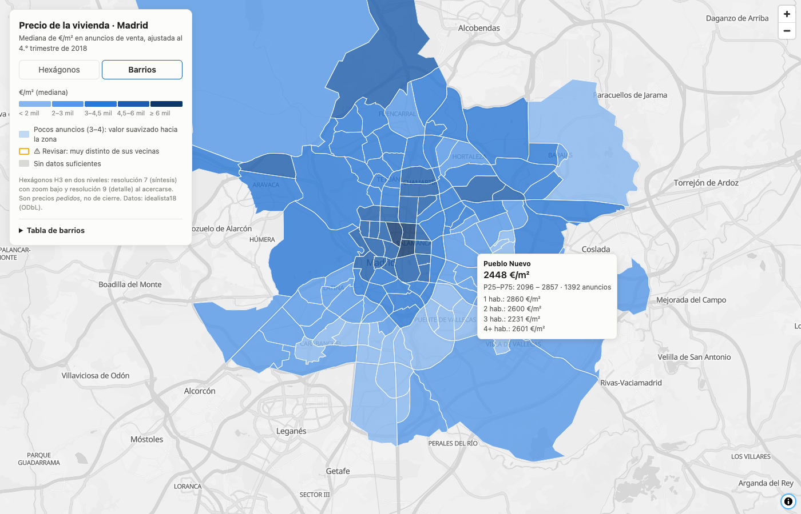

# GeoEstate

End-to-end geospatial pipeline that turns raw real-estate **listings** into a **price honeycomb**
and **neighbourhood prices**, served as **vector tiles** on an interactive map.

It is a personal learning project, inspired by the approach described in RealAdvisor's public
[price methodology](https://realadvisor.es/es/blog/metodologia-precio-vivienda): listing
deduplication, geolocation quality control, temporal adjustment, a two-level honeycomb
with smoothing in sparse areas, and automated checks against neighbouring cells.
It is not affiliated with RealAdvisor and does not reproduce its system.

```
                    Airflow DAG  listings_pipeline  (one task per step, retries, quality gates)
                    ┌──────────────────┬──────────────────────┬──────────────────┬───────────────┐
idealista18 ──► stage                ► core                 ► marts            ► clickhouse
(Madrid 2018)   clean, dedupe, H3      spatial join, geo QA,  H3 r9/r7, zones,   history +
                → PostGIS staging      time index (25830)     checks (atomic)    aggregates
                                                                    │                 │
                               map (Mapbox GL) ◄── Martin (MVT) ◄───┘     trends per zone
```



## Results on Madrid (one run, ~20 s on a laptop)

| Step | Rows |
|---|---|
| Raw listings | 94,815 |
| Duplicates removed (same asset, same quarter) | −19,011 |
| Snapped into polygon gaps (≤ 50 m from a zone) | 50 kept |
| Rejected: outside the city (21 in neighbouring municipalities, 1 in Andalusia) | −22 |
| **Clean listings in `core`** | **75,782** |
| Published cells: H3 r9 / H3 r7 / neighbourhoods | 1,556 / 69 / 135 (100% coverage) |
| Cells flagged as atypical vs. neighbours (for review) | 10 |

Quarterly time index (city median €/m², latest quarter = 1.0): Q1 ×1.087, Q2 ×1.047,
Q3 ×1.022. Asking prices rose ~8.7% during 2018. Most expensive neighbourhood: Recoletos
(7,718 €/m²); cheapest: San Cristóbal (1,203 €/m²).

Airflow: both runs green; the manual run waited in the queue (grey) because `max_active_runs=1`.



| Coarse honeycomb (H3 r7) | Neighbourhoods |
|---|---|
|  |  |

## Price model and market segments

Offline analyses on the same clean listings the map uses (`make model`, `make segments`,
no database needed, ~30 s each).

**Can a model value a flat better than the honeycomb?** Gradient boosting
(scikit-learn `HistGradientBoostingRegressor`) on log €/m² with 33 features: size, rooms,
amenities, floor, cadastral data, location. It is evaluated like a backtest: **trained on
Q1–Q3 2018, tested on Q4** (31,418 flats it never saw; any flat already seen in training is
dropped). The baseline is the honeycomb used as a valuation: the training median €/m² of
the flat's H3 r9 cell (r7, then city, when the cell has fewer than 5 listings).

| Q4 2018, 31,418 flats | Median error | Mean error | Within ±10 % | Within ±20 % |
|---|---|---|---|---|
| Honeycomb cell median (baseline) | 14.1 % | 18.7 % | 37 % | 66 % |
| **Gradient boosting** | **10.6 %** | **14.0 %** | **47 %** | **78 %** |

- Location dominates (latitude, distance to the Castellana axis and to the centre), then size,
  floor and lift (permutation importance).
- Both undervalue Q4 by about 4 %: asking prices kept rising and the model only knows earlier
  quarters. In production it would be retrained each quarter or corrected with the time index.
- These are asking prices, not sale prices: the model predicts what a flat would be listed at.

**What kinds of market are there?** k-means on 1,269 H3 cells (≥ 10 listings each, 73,916
listings) described by price, size, build year, amenities and distance to the centre,
standardised. k = 4 has the best silhouette score (0.36, k tested 3–7).

| Segment | Cells | Listings | €/m² | Built | Lift | Parking | Pool | Centre |
|---|---|---|---|---|---|---|---|---|
| Older outer districts | 589 | 30,504 | 2,050 | 1969 | 50 % | 9 % | 0 % | 5.7 km |
| New developments on the edge (66 % new build) | 42 | 1,665 | 2,689 | 2006 | 100 % | 92 % | 93 % | 10.5 km |
| Residential estates with pool and parking | 324 | 7,925 | 3,591 | 2001 | 100 % | 80 % | 81 % | 7.8 km |
| Central, older buildings | 314 | 33,822 | 4,576 | 1961 | 92 % | 15 % | 2 % | 2.5 km |

Segments show what a price map hides: an estate with a pool 8 km out and a flat in the centre
are different products for different buyers, even when their €/m² is not far apart.

## Data

[idealista18](https://github.com/paezha/idealista18) (ODbL): ~95k real sale listings from
Idealista for Madrid in 2018 (4 quarters), with price, size, features and coordinates,
plus 135 neighbourhood polygons. Real issues handled by the pipeline:

| Issue in the source | Handling |
|---|---|
| Same asset listed several times in one quarter, at different prices | keep lowest asking price per (asset, quarter) |
| Neighbourhood polygons don't tile perfectly (217 sliver gaps in their union) | listings ≤ 50 m from a zone are snapped to the nearest one (KNN), distance stored in `zone_distance_m` |
| Listings geolocated outside the city | rejected by spatial join, stored with reason, blocking gate if > 5% |
| Prices from four different quarters | city-wide quarterly index, prices expressed in latest-quarter terms |
| Sparse cells | shrinkage towards the parent H3 cell, `confidence` attribute, `n >= 3` to publish |
| Atypical cells | compared with their H3 neighbours on the **raw** median (smoothing would hide them), flagged for review |

Asking prices are not transaction prices: the outputs are asking-price indicators.

## Run it

Requirements: Docker, [uv](https://docs.astral.sh/uv/).

```bash
make install   # Python deps (uv)
make up        # PostGIS, ClickHouse, Airflow, Martin, frontend
make pipeline  # run all steps from the terminal (or trigger the DAG in Airflow)
open http://localhost:8080   # map
open http://localhost:8081   # Airflow UI (local, no login)
make trends    # price change per neighbourhood, from ClickHouse
```

`make test` runs the unit tests, `make lint` runs ruff + mypy. CI (GitHub Actions) runs those
plus the full pipeline twice against real PostGIS and ClickHouse services, to prove idempotency,
and checks that the Airflow DAG imports.

### On Kubernetes (local, kind)

```bash
make k8s-up    # kind cluster, geostate image, Services pointing at the databases
make k8s-job   # whole pipeline once, as a Job (steps as init containers)
# or, in Airflow, enable the DAG listings_pipeline_k8s: one pod per step
```

Optional: put a Mapbox token in `frontend/config.js` to render with Mapbox GL JS;
without it the map uses MapLibre GL JS (same API) with an OpenStreetMap basemap.

## Design

- **Layers**: `staging` (as loaded) → `core` (clean, one row per listing and quarter) → `marts` (served).
- **CRS**: compute in EPSG:25830 (ETRS89 / UTM 30N, metric, official for mainland Spain); marts
  in 4326; tiles in 3857 (done by Martin). Web Mercator is never used for measurements.
- **Idempotent steps**: every step deletes and rewrites its city, so retries and re-runs are safe.
- **Atomic publish**: marts and their quality gates run in one transaction; if a gate fails,
  the transaction rolls back and the map keeps serving the last good version.
- **Orchestration**: each step is a CLI command (`geostate stage|core|marts|clickhouse`) that
  exchanges data through the database, not memory. The Airflow DAG only orchestrates: one task
  per step, the package lives in its own virtualenv inside the Airflow image (no dependency
  clashes), infrastructure errors are retried with backoff, and quality-gate failures
  (exit code 2) fail fast without retry. `max_active_runs=1` because runs rewrite the same tables.
- **Kubernetes**: a standalone image (`docker/geostate.Dockerfile`: multi-stage, non-root,
  entrypoint `geostate`) runs each step in its own pod via `KubernetesPodOperator`. CPU/memory
  requests come from the measured peak memory of each step (`stage` ~540 MiB parsing the R file,
  the rest < 200 MiB because the work is in SQL). The databases stay outside the cluster, as
  managed services would in production; pods reach them through Services without a selector.
  Config in a ConfigMap, credentials in a Secret created at deploy time (never committed).
  A small operator subclass keeps the error policy: exit code 2 from a pod = no retry.
- **ClickHouse**: flat, enriched copy of clean listings (`MergeTree`, partitioned by
  city and month) plus an `AggregatingMergeTree` fed by a materialized view (quarterly median
  per zone). Re-runs drop the city's partitions in both tables first: a materialized view
  only reacts to inserts, so stale aggregates would otherwise be double counted.

## Layout

```
src/geostate/       extract · transform · spatial · load · quality · clickhouse · pipeline · cli
                    price_model · segments (offline analyses)
src/geostate/sql/   schema.sql · core.sql · marts.sql · clickhouse_*.sql
dags/               Airflow DAGs: local venv and Kubernetes pods (orchestration only)
k8s/ · scripts/     kind config, manifests (namespace, config, Services, Job), setup script
tests/unit/     pure-function tests (no database needed)
docker/         pipeline image, Airflow image, Martin config, Postgres init
frontend/       single-page map
```

## Roadmap

- [x] Phase 1: listings → PostGIS → H3 honeycomb → vector tiles → map
- [x] Phase 2: Airflow DAG, ClickHouse for price history, CI
- [x] Phase 3: Kubernetes (kind), one pod per step with KubernetesPodOperator
- [x] Price model vs. honeycomb baseline (time-based test), k-means market segments
- [ ] Airflow itself on Kubernetes (official Helm chart), image registry + CI deploy
- [ ] Street-level prices (OpenStreetMap streets), Barcelona and Valencia
